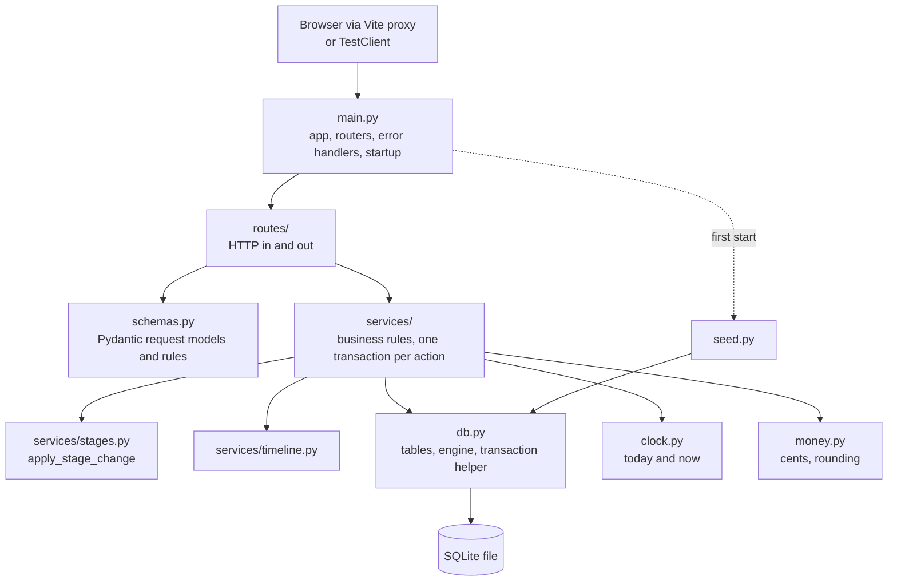
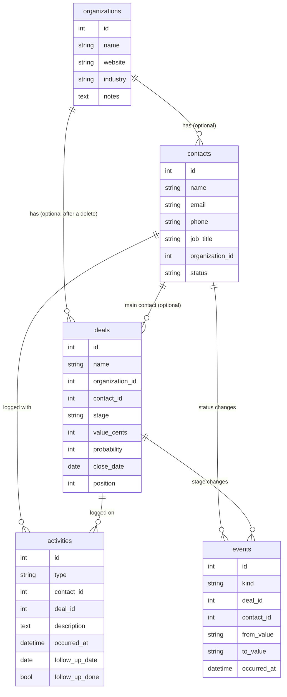
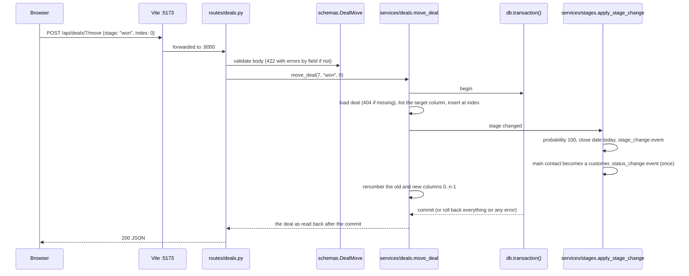

# Backend architecture

How the FastAPI app in `backend/` is put together: its layers, the data model, how a request flows through it, and the decisions behind the less obvious parts. The requirements live in `docs/spec.md`, and IDs such as `ARC-04` point there. This document describes the code as built. Its companion is `docs/frontend-architecture.md`.

## At a glance

- Python 3.12, managed by uv (`pyproject.toml` and `uv.lock` at the repo root).
- FastAPI and Pydantic for HTTP and validation, SQLAlchemy Core (no ORM, no raw SQL) for the database, and uvicorn to serve it.
- One SQLite file: `data/accountable.db`, or whatever `ACCOUNTABLE_DB` points to. It is created and filled with sample data on first start.
- Every business rule lives here; the frontend only shows and formats. The JSON API under `/api` is the only way in, so a hosted Postgres can replace SQLite later without touching the screens.
- About 2.100 lines of Python in 20 modules, plus 153 pytest tests in 16 files.

## Layers



The rules for each layer (`ARC-02`):

- **Routes** only handle HTTP: they declare the path, take a validated Pydantic body, call one service function and return what it gives back. They hold no rules.
- **Services** hold every rule: stage changes, close dates, the customer change, delete cascades, timelines, dashboard figures. Each user action is one call that runs in one transaction.
- **`db.py`** holds the schema and the connection helpers. Nothing else creates an engine.
- **`clock.py`** is the only code that reads the current date or time (`ARC-12`).

## Folder layout

```
backend/
  main.py              FastAPI app, routers, JSON error handlers, startup (create tables, seed if new)
  db.py                engine from ACCOUNTABLE_DB, the five tables, transaction() and reading()
  clock.py             today() and now(), honouring ACCOUNTABLE_TODAY
  money.py             half-up rounding, expected revenue in cents
  schemas.py           request models with the field rules and their messages; 422 formatting
  seed.py              seed(conn, today, now) and the `python -m backend.seed [--empty]` command
  routes/
    organizations.py   /api/organizations
    contacts.py        /api/contacts
    deals.py           /api/deals, including /move
    activities.py      /api/activities, including /done
    dashboard.py       /api/dashboard
    meta.py            /api/today, /api/industries
  services/
    common.py          NotFound, ValidationFailed, one(), exists()
    stages.py          the stage table, is_late(), apply_stage_change(), make_customer()
    organizations.py   CRUD, list with counts, delete impact, industries
    contacts.py        CRUD with status-change events, delete impact
    deals.py           CRUD, move, column renumbering, delete impact
    activities.py      log, edit, delete, mark done
    timeline.py        deal, contact and organization timelines; every entry for the dashboard
    dashboard.py       every figure GET /api/dashboard returns
  tests/               pytest: one fresh database and a fixed clock per test
```

## Data model

Five tables, declared in `db.py` with SQLAlchemy's generic types (`Integer`, `String`, `Date`, `DateTime`, `Boolean`), so the same definitions work on Postgres. Every table has `id`, `created_at` and `updated_at`, set by the server (`DM-06`).



- **Money** is whole cents in an integer, and probability is whole percent. Expected revenue is summed as `value_cents × probability` and divided by 100 once, at the end, rounding half up (`money.py`, `ARC-05`).
- **An activity belongs to exactly one record**, a contact or a deal. A check constraint enforces it, built from SQLAlchemy expressions rather than SQL text.
- **Events are the automatic entries**: `stage_change` on a deal and `status_change` on a contact. They're kept apart from activities because they have a different shape and can't be edited or deleted by hand (`ARC-06`).
- **`position`** is the card's place in its pipeline column, counting 0, 1, 2… within each stage (`ARC-08`).
- **No migrations yet.** Tables are made with `metadata.create_all`. If the schema changes during the MVP, `npm run seed` rebuilds the database (`ARC-03`).

### Foreign keys and deletes

Foreign keys are declared but not enforced: SQLite only enforces them after a raw `PRAGMA`, which the stack rules out. The services do the unlinking and cascading themselves, in the same transaction as the delete (`ARC-04`):

| Deleting | Also does |
|---|---|
| an organization | sets `organization_id` to empty on its contacts and deals (`DEC-01`) |
| a contact | deletes their activities and status events; sets `contact_id` to empty on their deals |
| a deal | deletes its activities and stage events; renumbers its column |

Each kind has a `delete-impact` endpoint that counts what the delete will do, so the frontend can say it in plain words before the user confirms. `test_deletes.py` checks the counts against what the delete then actually does.

## A request, end to end



- Reads go through `db.reading()`, and every write goes through `db.transaction()` (`engine.begin()`). Services reach the helper as `db.transaction` at call time, which is how `test_transactions.py` swaps in a connection that fails partway.
- After a write, the service reads the record back in a fresh read and returns it. That way the response always matches what was stored.

## The stage rules: one function for the form and the board

A deal's stage can change from the deal form (`PUT /api/deals/{id}`) or from a drag on the board (`POST /api/deals/{id}/move`). Both call `services/stages.apply_stage_change`, so the rules can't drift apart (`ARC-02`):

1. **Probability** becomes the new stage's usual figure (New 10, Qualified 25, Proposal 50, Negotiation 75, Won 100, Lost 0), unless the form chose another (`RULE-02`).
2. **Close date** becomes today when a deal moves to Won or Lost, unless the form chose another. Moving back out keeps the date, so a past date makes the deal late at once (`DEC-07`).
3. **An event** `stage_change` is written with the stage it came from and went to (`RULE-04`).
4. **Winning** makes the main contact a customer, with a `status_change` event. Nothing happens with no main contact, or when they're already a customer. Moving a won deal back out leaves them a customer (`RULE-05`, `DEC-08`).

How a `PUT` tells "chosen in the form" apart from "left alone": when the stage changes, a probability or close date that still equals the deal's old value counts as not chosen, so the stage's figure and today apply. Without a stage change, a probability set by hand is kept (`RULE-03`).

Other stage-related behaviour:

- **New deals** take their stage's probability unless one is given (`RULE-01`). They go to the top of their column; a deal created as Won makes its contact a customer.
- **Late** (`is_late`) means open, with a close date before today (`RULE-06`). The deals list and each deal carry a `late` flag.
- **Moves** insert the card at the given index, clamped to the column's length, then renumber the column it left and the column it joined, 0 to n-1.

## Timelines

Timelines are worked out when they're read; nothing is stored twice (`ARC-07`). `services/timeline.py` merges activities and events into one list of entries, newest first (`TL-04`):

| Timeline | Contains | Labelled with |
|---|---|---|
| Deal (`TL-01`) | its activities and stage changes | nothing; all its own |
| Contact (`TL-02`) | their activities and status changes, plus the activities and stage changes of every deal where they're the main contact now | `source: {kind: "deal", ...}` on deal entries ("on deal Acme renewal") |
| Organization (`TL-03`) | everything on its contacts' and its deals' timelines, each entry once | the contact or deal each entry came from |

Because a contact's timeline is built from the deals they're the main contact of *now*, changing a deal's main contact moves its history to the new contact with no extra work. The dashboard's recent activity uses `all_entries()`, which tags each entry with its `record` (and the deal's organization name) for the links.

## The dashboard

`services/dashboard.get_dashboard()` returns every figure in one response (`API-15`). It runs a handful of queries and works the rest out in Python; at a few hundred records that takes milliseconds.

| Figure | How |
|---|---|
| Open pipeline, open deal count | open deals' values |
| Expected revenue | `total_expected_cents` over open deals, rounded once |
| Won this month, last month, change | won deals by close date in each calendar month; the change is in whole percent, or `null` when last month is 0 |
| Follow-ups due | not done, with a date up to 7 days ahead, grouped as overdue, today or week (`DEC-11`) |
| 12 months | won value and count, and lost count, per month, from 11 months ago to this month |
| Funnel | open deals, plus deals closed in the window, counted towards every stage they reached (`DEC-10`) |
| Pipeline by stage | count, value and expected revenue per open stage |
| Recent activity | the 10 newest entries with `occurred_at` up to now |

How the funnel decides which stages a deal reached:
- An **open** deal reached its current stage and every open stage before it.
- A **won** deal reached every stage.
- A **lost** deal reached every stage up to the one it was lost from. That comes from its last `stage_change` event into Lost; with no history, it reached New only.

## Validation and errors

- **Request models** in `schemas.py` hold the field rules: required names, lengths, the email pattern, values of 0 or more, probabilities from 0 to 100, known stages and statuses, and exactly one record for an activity.
- **Their messages match the frontend's zod schemas word for word**, for example "Enter a name" and "Probability must be between 0 and 100". `shared/validation-cases.json` checks both sides against the same examples (`ARC-11`).
- **Required fields** default to `None` with `validate_default=True`. A missing field and a blank one then give the same friendly message, rather than Pydantic's "Field required".
- **Rules that need the database**, such as "that organization no longer exists", are raised by the services as `ValidationFailed`.

`main.py` turns every error into JSON (`API-17`):

| Error | Status | Body |
|---|---|---|
| Invalid body (Pydantic) or `ValidationFailed` | 422 | `{"detail": "Check the highlighted fields", "errors": {"field": "message"}}` |
| `NotFound` from a service | 404 | `{"detail": "That deal doesn't exist"}` |
| Any other HTTP error | its own status | `{"detail": "..."}` |
| Anything unexpected | 500 | `{"detail": "Something went wrong on the server"}`, with the traceback logged |

## The clock

`clock.now()` and `clock.today()` are the only sources of the current time.

- With no setting, they return the computer's local date and time, to the second.
- `ACCOUNTABLE_TODAY=2026-11-23` fixes the date and keeps the real time of day. The end-to-end tests use this.
- `ACCOUNTABLE_TODAY=2026-11-23T14:00:00` fixes the time as well. The backend tests use this.

`GET /api/today` hands the same values to the browser, so the frontend never uses its own clock (`DEC-12`).

## Startup and sample data

- **On startup** (`main.prepare_database`), the app checks whether the database file exists, then creates any missing tables. Only a file that didn't exist before is seeded, so restarting never overwrites your changes (`RUN-05`).
- **`seed.py`** builds the sample data with `seed(conn, today, now)`. Every date is relative to today, so the dashboard's 12 months are always full (`DEC-13`). The same function serves startup and `npm run seed` (`ARC-13`).
- **The data** is written out as plain lists in the module: 10 organizations, 25 contacts, 30 deals with their stage paths, 18 follow-ups and 16 notes, plus two activities generated for each closed deal.
  - On 23 Nov 2026 it reproduces mockup B's figures exactly.
  - Times are kept in working hours, and never later than now.
  - A fixed random seed keeps every reset the same.
- **`python -m backend.seed`** (`npm run seed`) clears every table and reseeds in one transaction. That works while the app is running: SQLite's 10-second busy timeout makes readers wait out the write (`RUN-03`). With `--empty`, it leaves every table empty.

## Configuration

| Setting | Default | Used for |
|---|---|---|
| `ACCOUNTABLE_DB` | `data/accountable.db` | the database file; the folder is created if needed |
| `ACCOUNTABLE_TODAY` | not set | fixes the date, or the date and time |
| `--port` (uvicorn) | 8000 from `npm run dev` (`BACKEND_PORT`) | where the API listens; 8100 in the end-to-end tests |

The engine is cached per database path. Tests switch `ACCOUNTABLE_DB` and call `db.dispose_engines()` to start clean.

## API

| Method and path | Service function |
|---|---|
| `GET /api/organizations` | `organizations.list_organizations` (with contact count, open deal count, open value) |
| `POST /api/organizations`, `PUT /{id}`, `DELETE /{id}` | `create_`, `update_`, `delete_organization` |
| `GET /api/organizations/{id}` | `get_organization` (contacts, deals, timeline) |
| `GET /api/organizations/{id}/delete-impact` | `organizations.delete_impact` |
| `GET /api/contacts`, `POST`, `GET /{id}`, `PUT /{id}`, `DELETE /{id}` | `contacts.*`; the detail has their organization, deals and timeline |
| `GET /api/contacts/{id}/delete-impact` | `contacts.delete_impact` |
| `GET /api/deals`, `POST`, `GET /{id}`, `PUT /{id}`, `DELETE /{id}` | `deals.*`; each deal has `late` and `expected_cents`, and the detail has its timeline |
| `POST /api/deals/{id}/move` | `deals.move_deal` |
| `GET /api/deals/{id}/delete-impact` | `deals.delete_impact` |
| `POST /api/activities`, `PUT /{id}`, `DELETE /{id}` | `activities.*` |
| `POST /api/activities/{id}/done` | `activities.set_done` |
| `GET /api/dashboard` | `dashboard.get_dashboard` |
| `GET /api/industries` | `organizations.industries` (in use, each once, sorted) |
| `GET /api/today` | `clock.now` |

Lists return every record; search and sorting run in the browser (`ARC-09`). FastAPI's own docs for all of these are at `/docs` on the backend's port.

## Testing

`backend/tests/conftest.py` gives every test a fresh temporary database file, the clock fixed at 23 Nov 2026 14:00, and a `TestClient`. The client isn't used as a context manager, so startup (and its seeding) doesn't run unless a test asks for it. An `api` helper creates records through the real endpoints.

| File | Covers |
|---|---|
| `test_organizations.py`, `test_contacts.py`, `test_deals.py`, `test_activities.py` | each endpoint, its 422 messages and 404s |
| `test_stage_rules.py` | every stage rule, each run through both `PUT` and `move` |
| `test_move.py`, `test_late.py` | renumbering, empty columns, indexes past the end; late deals |
| `test_deletes.py`, `test_transactions.py` | every delete rule; a delete and a move that fail partway leave every table as it was |
| `test_timeline.py` | the roll-ups, de-duplication, and the main contact changing |
| `test_dashboard.py` | every figure on a small known data set, including rounding and month edges |
| `test_seed.py`, `test_startup.py` | the sample data's counts and mix, mockup B's figures, reseeding while reading, seeding only a new file |
| `test_validation_cases.py`, `test_meta.py`, `test_speed.py` | the shared validation cases, `/today` and `/industries`, every GET under 200 ms |

`npm run test:backend` runs them; `npm test` runs them with everything else (see `AGENTS.md`).

## Adding to it

- **A new field on a record:**
  1. Add the column in `db.py`. Run `npm run seed` to rebuild, since there are no migrations yet.
  2. Add the rule and its message in `schemas.py`.
  3. Add cases to `shared/validation-cases.json`, then the matching zod rule on the frontend.
- **A new rule:** put it in the service, never in the route. If it touches stages, put it in `apply_stage_change`, so the form and the board both get it.
- **A new endpoint:**
  1. Add a request model in `schemas.py` if it takes a body.
  2. Add a service function that opens its own `db.transaction()` or `db.reading()`.
  3. Add a thin route that calls it, and include the router in `main.py` if it's a new module.
- **Moving to Postgres** (with Supabase):
  1. Point the engine at Postgres.
  2. Add Alembic for migrations.
  3. Turn on real foreign keys if wanted.

  The service-level cascades can stay as they are.
