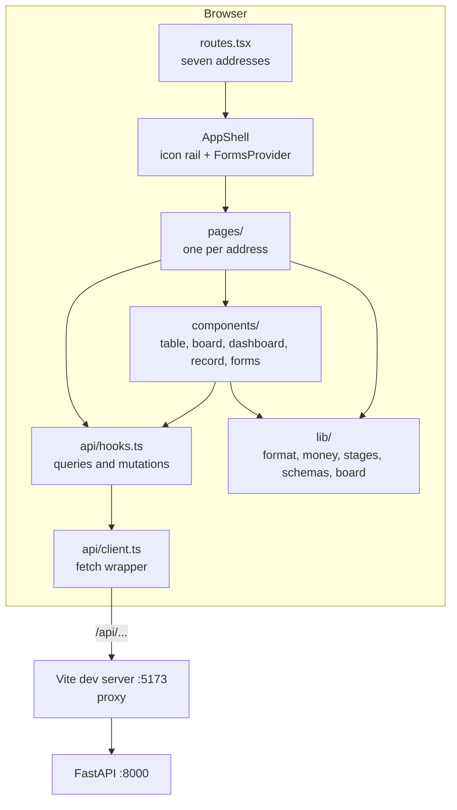
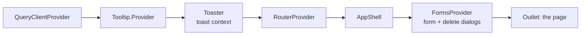
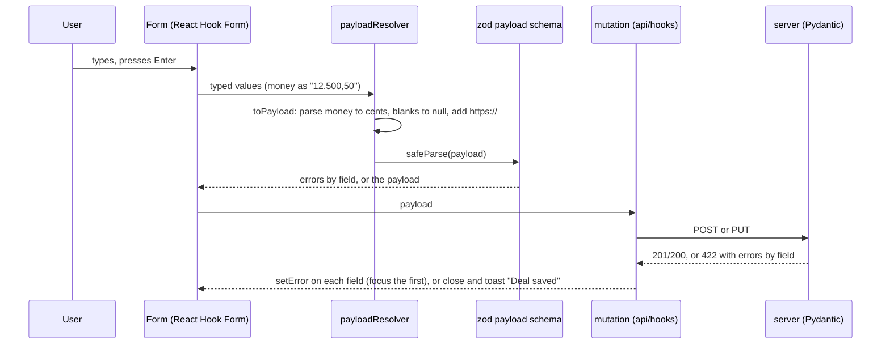
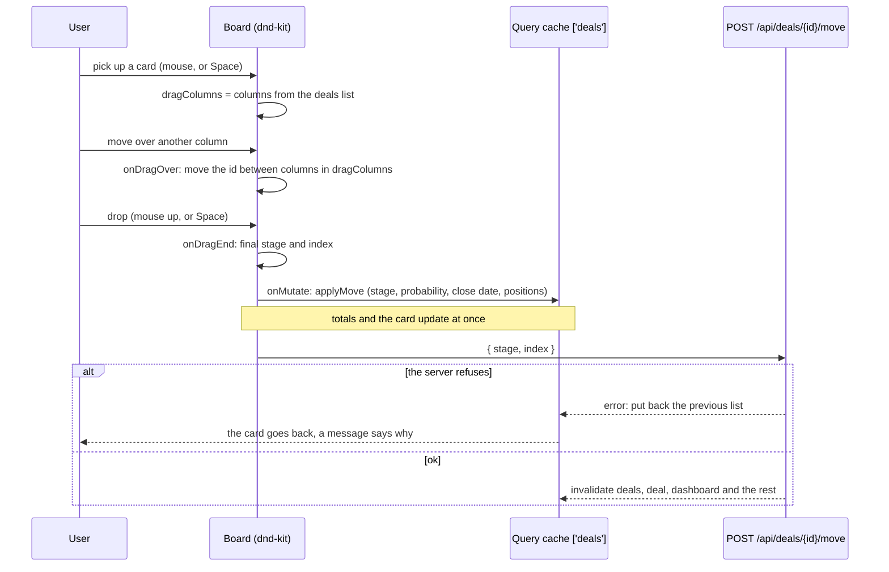

# Frontend architecture

How the React app in `frontend/` is put together: its layers, how data moves through it, and the decisions behind the less obvious parts. The requirements live in `docs/spec.md`, and IDs such as `ARC-10` point there. This document describes the code as built.

## At a glance

- A single-page React 19 app, served by Vite on port 5173 in development.
- It only ever calls `/api/...`. Vite forwards those calls to FastAPI (`BACKEND_PORT`, default 8000), so the browser talks to one address and there's no CORS setup (`ARC-01`).
- Every business rule lives on the server. The frontend fetches, formats, validates as you type, and shows.
- About 5.600 lines of TypeScript in 77 files, with 9 Vitest files beside the code.

| Concern | Library | Where |
|---|---|---|
| Routing | React Router 7 | `routes.tsx` |
| Server data | TanStack Query 5 | `api/hooks.ts` |
| Tables | TanStack Table 8 | `components/table/DataTable.tsx` |
| Drag and drop | dnd-kit (core 6, sortable 10) | `components/board/` |
| Charts | Recharts 3 | `components/dashboard/` |
| Dialogs, menus, popovers, tooltips, toasts | Radix UI | `FormDialog`, `ConfirmDeleteDialog`, `Timeline`, `RecordSelect`, `RailLink`, `Toaster` |
| Searchable select | cmdk | `components/RecordSelect.tsx` |
| Forms | React Hook Form 7 with zod 4 | `components/forms/`, `lib/schemas.ts` |
| Icons | lucide-react | throughout |
| Fonts | `@fontsource` (Instrument Sans, Instrument Serif, JetBrains Mono) | `main.tsx` |
| Styling | CSS Modules and CSS variables | `styles/tokens.css`, `*.module.css` |

## Layers



The rules for each layer:

- **Pages** read data through hooks and lay out components. They decide where to go after a delete, and which form to open.
- **Components** are presentational where they can be. The ones that save something (forms, the follow-up checkbox) call mutation hooks themselves.
- **`lib/`** holds pure functions with no React in them. That's where the unit tests concentrate.
- **`api/`** is the only code that knows URLs. Nothing else calls `fetch`.

## Folder layout

```
frontend/src/
  main.tsx              fonts, global styles, mounts <App/>
  App.tsx               providers: query client, tooltips, toasts, router
  routes.tsx            the seven addresses under AppShell
  api/
    client.ts           fetch wrapper; ApiError with per-field errors
    hooks.ts            one hook per endpoint, query keys, invalidation, optimistic move
    types.ts            response types, matching the backend's JSON
  lib/
    format.ts           dates, money, percentages, relative dates (DES-05)
    money.ts            parseMoney for form input (DEC-04)
    stages.ts           stage and status tables, colours, isLate, totals (RULE-06, RULE-07)
    schemas.ts          zod payload schemas, form value types, form resolvers (ARC-11)
    board.ts            board state as stage -> ordered ids; applyMove
    deleteText.ts       the delete dialog's wording (UI-DEL-01)
    today.ts            today and now from the server (DEC-12)
  components/
    AppShell, IconRail, RailLink, PageHeader, Panel, Button, Badges,
    EmptyState, Skeleton, LoadError, Toaster, FormDialog,
    ConfirmDeleteDialog, fields, RecordSelect, SuggestField
    table/              DataTable, SearchBox, SortableHeader, RowActions, StatusFilter
    forms/              FormsProvider, useSubmit, Organization/Contact/Deal/ActivityForm
    record/             RecordParts (header, facts, linked lists, columns),
                        Timeline (+ entries), FollowUpCheckbox
    board/              Board, StageColumn, ColumnHeader, DealCard, BoardTotals, keyboard
    dashboard/          HeadlinePanel, RevenueChart, FunnelChart, PipelineByStage,
                        WonLostChart, FollowUpList, ActivityFeed
  pages/                Dashboard, Pipeline, Deals, Contacts, Organizations,
                        Deal, Contact, Organization, NotFound, recordShared
  styles/               tokens.css, global.css
  test/                 setup.ts (jsdom shims), utils.tsx (providers, mock fetch)
```

## Providers and routing

The providers wrap the app in this order, outermost first:



- `FormsProvider` sits inside the router, so the forms can use router hooks. It sits inside `Toaster`, so saves can confirm with a message.
- The query client retries a failed read once. Data counts as fresh for 5 seconds, and nothing refetches on window focus, apart from `today`.

| Address | Page | Main components |
|---|---|---|
| `/` | `DashboardPage` | `HeadlinePanel` (`RevenueChart`), `FunnelChart`, `PipelineByStage`, `WonLostChart`, `FollowUpList`, `ActivityFeed` |
| `/pipeline` | `PipelinePage` | `BoardTotals`, `Board` > `StageColumn` > `ColumnHeader`, `DealCard` |
| `/deals`, `/contacts`, `/organizations` | `DealsPage`, `ContactsPage`, `OrganizationsPage` | `DataTable`, `RowActions`, `StatusFilter` (contacts) |
| `/deals/:id`, `/contacts/:id`, `/organizations/:id` | `DealPage`, `ContactPage`, `OrganizationPage` | `RecordHeader`, `FactList`, `LinkedList`, `Timeline`, `LogActivityForm` |
| anything else | `NotFoundPage` | `EmptyState` |

The rail marks the current page with `useMatch` rather than `NavLink`'s `className` function. Radix's `Slot`, used by the tooltip trigger, can't merge a function `className`, and with it the rail lost its styles.

## Data layer

### Reads

Every read is a TanStack Query hook in `api/hooks.ts`, keyed as below. Lists come whole: search, sorting and filtering run in the browser (`ARC-09`).

| Hook | Key | Endpoint |
|---|---|---|
| `useToday` | `['today']` | `GET /api/today` (refetched on window focus) |
| `useOrganizations`, `useOrganization(id)` | `['organizations']`, `['organization', id]` | `GET /api/organizations[/id]` |
| `useContacts`, `useContact(id)` | `['contacts']`, `['contact', id]` | `GET /api/contacts[/id]` |
| `useDeals`, `useDeal(id)` | `['deals']`, `['deal', id]` | `GET /api/deals[/id]` |
| `useDashboard` | `['dashboard']` | `GET /api/dashboard`, refetched every time the dashboard opens (`UI-DASH-08`) |
| `useIndustries` | `['industries']` | `GET /api/industries` |

A record page's detail response already carries its linked records and its timeline, so each page makes one request.

### Saves and invalidation

Each save is a mutation. On success it invalidates every key that the kind of record touches (`ARC-10`). Only queries currently on screen refetch; the rest refetch when next shown.

| A save of | Invalidates |
|---|---|
| an organization | organizations, organization, contacts, contact, deals, deal, dashboard, industries |
| a contact | contacts, contact, organizations, organization, deals, deal, dashboard |
| a deal (form or board) | deals, deal, organizations, organization, contacts, contact, dashboard |
| an activity, or a follow-up ticked done | deal, contact, organization, dashboard |

When a record is deleted, its own detail query is removed before invalidating, so an open record page doesn't refetch into a 404.

### Errors

`api/client.ts` turns every failure into an `ApiError`:

- **Network failure** (status 0): "Couldn't reach the server. Check that Accountable is running."
- **422**: `fieldErrors`, one message per field. The forms put them on their fields.
- **Anything else**: the server's `detail` text.

What the screens do with these (`UI-ERR-01`):
- A list that fails to load shows `LoadError` with a "Try again" button, instead of a blank page.
- A save that fails shows "Couldn't save the deal. Try again." at the bottom right, and the form stays open with what was typed.

### Today comes from the server

The browser's clock is never used (`DEC-12`). Late deals, relative follow-up dates, the activity form's default "now", and the close date filled in when a deal is won all read `useTodayValue()`. That way the end-to-end tests can fix the date on the server with `ACCOUNTABLE_TODAY`.

## Forms



- **One frame for every form.** `FormsProvider` owns a single `FormDialog` and a single `ConfirmDeleteDialog`. Any screen opens them through `useForms()`:
  - `openForm({ kind: 'deal', record?, defaults? })`
  - `confirmDelete({ kind: 'deals', id, onDeleted? })`

  Pipeline columns, table rows, record pages and the organization page's "New" buttons all share the same forms that way. The form is keyed by how many times it has been opened, so its default values reset each time.
- **Form fields share the payload's names** (`value_cents`, `organization_id`, ...), so an error from zod or from the server lands on the right field with no mapping. Money and probability are text while being typed, and become numbers in `toPayload`.
- **One set of rules, checked twice.** The zod payload schemas in `lib/schemas.ts` copy the Pydantic rules word for word. `shared/validation-cases.json` is run against both, by `schemas.test.ts` and by `test_validation_cases.py` (`ARC-11`). The form resolver is a small function of our own, `payloadResolver`, rather than `@hookform/resolvers`, because it has to convert money before validating.
- **`useSubmit`** handles the three outcomes in one place:
  - success: a message, then `onSaved`
  - a 422: an error on each field, with focus on the first
  - any other failure: an error message, with the form left open.
- **Keyboard** (`UI-FORM-01`):
  - The dialog focuses its first field when it opens.
  - Enter submits, as a native form does.
  - In a text area, Enter starts a new line.
  - In the searchable select and the industry suggestions, Enter picks the highlighted option.
  - Escape closes the open popover first, then the dialog.
- **Custom fields:**
  - `RecordSelect` is a Radix Popover with cmdk inside. It can group options, which is how the deal form lists the chosen organization's contacts first (`UI-FORM-03`).
  - `SuggestField` is a combobox with an inline list of industries already in use (`UI-FORM-06`).

## The pipeline board

The board is the most involved component. Its state while dragging is a plain map from stage to ordered deal ids (`lib/board.ts`). Positions are worked out by the server; the client only keeps the order.



- **One `DndContext`, one `SortableContext` per column.** Each column is also a `useDroppable`, so an empty column still accepts a drop (`UI-PIPE-08`).
- **Sensors:**
  - Pointer, with a 5px activation distance, so a click still opens the deal.
  - Keyboard: Space picks up and drops, the arrows move, and Escape cancels. Enter is left free to open the deal.
- **Keyboard movement** uses `components/board/keyboard.ts` rather than dnd-kit's default. The default compares rectangles, and the dragged card's 2-degree tilt made cards in its own column look "to the right". The board's version moves left and right between neighbouring columns, and up and down within the column.
- **The look while dragging** (`DES-04`):
  - The drag overlay is a white card with a stronger shadow and the tilt.
  - The card's place in the column becomes a gap tinted with the column's stage colour, with a 2px ring.
- **Totals** come from `lib/stages.ts` `totals()`. It adds up open deals only and rounds half up once, at the end. `BoardTotals` and each `ColumnHeader` work their figures out from the same list, so they move together (`UI-PIPE-01`, `UI-PIPE-03`).
- **After a drop**, the board keeps its dropped order until the deals list changes (the optimistic update, or the rollback). Without that, the card would flick back for a frame.

## The dashboard

`DashboardPage` makes one request, `GET /api/dashboard`. The server works out every figure; the page only lays them out and formats them.

| Panel | Built with | Notes |
|---|---|---|
| Headline (Midnight) | HTML and `RevenueChart` (Recharts `LineChart`) | round axis ticks from `niceTicks`; the current month's dot is larger and labelled; a white tooltip with the full figure |
| Sales funnel | HTML columns | heights relative to New; the stage name and value under each column |
| Pipeline by stage | HTML buttons | solid stage colours; each row opens `/pipeline` |
| Won and lost | Recharts `BarChart`, `stackOffset="sign"` | won above the line, lost below; a hidden table gives screen readers the numbers |
| Follow-ups | `FollowUpList` | Overdue, Today, Next 7 days, as the server grouped them; ticking a box marks the follow-up done |
| Recent activity | `ActivityFeed` | shares `entryText` and `entryIcon` with the record timelines |

While the request is out, every panel shows grey placeholders in its own place, so nothing jumps (`UI-EMPTY-05`). With no data, every panel shows its own empty line (`UI-EMPTY-02`, `UI-EMPTY-04`).

## Tables

`DataTable` is one generic component used by all three list pages:

- **Search:** TanStack's global filter, over the text columns only. Columns marked `mono` (money, counts) are left out.
- **Sorting:** names A to Z by default. A heading click sorts ascending, then descending, with `aria-sort` set.
- **Extra filter:** an optional `filterRows`, which the contacts page uses for the status buttons.
- **Footer and states:** the "12 of 25 contacts" count, placeholder rows while loading, an empty state, and a "no matches" state with Clear search.
- **Rows:** each row can be focused with Tab and opens on Enter or click. A click on a link or button inside the row isn't treated as opening the row.

The rows handed to TanStack Table are memoized, and its auto-reset is turned off. A new array on every render made it reset its state on every render, and the page froze as soon as a dialog opened.

## Styling

- `styles/tokens.css` defines every colour, font, radius, spacing step and shadow as a CSS variable, named by role (`--page`, `--muted`, `--raspberry-text`...). A dark mode would only redefine these (`ARC-15`, `DES-01`).
- Each component has its own CSS Module. `styles/global.css` holds only the reset, the focus ring and a few utility classes (`mono`, `visually-hidden`, `muted-text`, `late-text`, `pre-line`).
- Inline styles are used only for values that come from data: a stage's colour, a funnel column's height, a skeleton's size.
- **Breakpoints:**
  - Below 1360px, pipeline column headers move the count beside the expected revenue.
  - Below 1320px, the main area's padding and the board's gaps shrink, so all six columns fit at 1280px.
  - Below 1280px, the headline panel stacks and the dashboard rows become two columns.
  - Below 1000px, the dashboard rows become one column.
- **Brand rules kept:** no gradients, no lines on one edge of a panel, 20px panels, 14px cards and rows, 12px controls, and a 2px Sea Green focus ring with a 2px gap (`DES-04`).

## Formatting

All formatting lives in `lib/format.ts`, with its own unit tests (`DES-05`):

- Dates arrive as ISO text and are split by hand, so the browser's time zone can never shift a day.
- Money is integer cents everywhere and is only turned into text for display:
  - `formatMoney`: `$12.500,00`
  - `formatMoneyWhole`: `$412.500`
  - `formatMoneyShort`: `$86k`, `$1,2M`

`lib/money.ts` `parseMoney` reads what people type. It accepts `12500`, `12.500`, `12.500,50` and `$12.500,00`. It turns down anything unclear, such as `12.5`, with a message rather than guessing.

## Accessibility

- **Names for icon-only controls.** Every icon button has an accessible name: the rail links, row actions ("Edit Acme Ltd"), the timeline menus, the contact initials on cards.
- **Dialogs** use Radix. On the delete dialog, Cancel has focus.
- **Live messages.** Toasts are Radix live regions, and the table footer is `aria-live`.
- **Board.** dnd-kit's screen reader instructions and announcements are written in the app's own words.
- **Charts.** Every coloured mark has a text label beside it. The won and lost chart also has a hidden data table.

## Testing

| Level | Where | What |
|---|---|---|
| Unit (Vitest, jsdom) | next to the code, `*.test.ts(x)` | `lib/` (formats, money, stages, schemas with the shared cases), `DataTable`, `DealForm`, `ConfirmDeleteDialog`, `Board` totals, `DashboardPage` placeholders |
| End to end (Playwright, Chrome) | `e2e/` | every screen against a real backend on ports 8100 and 5273, with the date fixed; fails on any console error or warning |

`test/utils.tsx` gives component tests the real providers and a fake `fetch` keyed by `"METHOD /api/path"`. `npm test` runs both levels along with the backend tests (see `AGENTS.md`).

## Adding to it

- **A new endpoint:**
  1. Add its response type in `api/types.ts`.
  2. Add a hook in `api/hooks.ts` with a key.
  3. If it saves, add its scope to the invalidation table there.
- **A new form field:**
  1. Add it to the zod payload schema and the form's value type in `lib/schemas.ts`.
  2. Add its good and bad cases to `shared/validation-cases.json`.
  3. Add the field to the form with a `Field` wrapper.
- **A new screen:**
  1. Add a page in `pages/`.
  2. Add a route in `routes.tsx`, and a `RailLink` in `IconRail` if it's a section.
  3. Build it from `PageHeader` and `Panel`.
  4. Give each panel a placeholder, an empty state and a `LoadError`.
